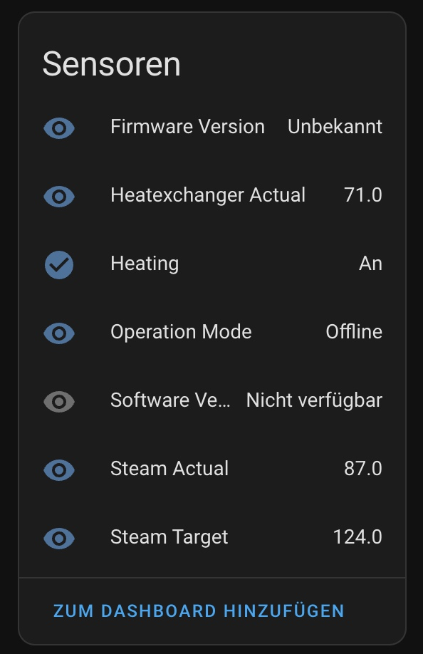
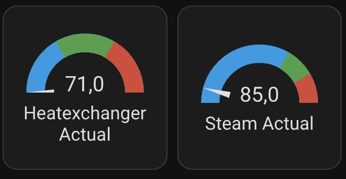

# Home Assistant Integration for Lelit MaraX with ESPHome

I build an integration for my Lelit MaraX Espresso Machine (first generation) for Home Assistant.

This integration is based on this great [Reddit article](https://www.reddit.com/r/espresso/comments/hft5zv/data_visualisation_lelit_marax_mod)

A Wemos D1 mini (ESP8266) with its own power supply is connected to the PID of the MaraX via UART.
On top of the serial data it provides a shot timer (reed switch on the pump) and detects an empty water tank.

## Serial data

The coffee machine sends the following data about 4 times a second:

C123b,095,112,063,1095,1

First Character: C or S for Coffee-/Steam-Priority. Followed by the current firmware version.
Second value: Actual steam temperature
Third value: Target steam temperature
Fourth value: Actual Heatexchanger temperature
Fifth value: Remaining timer for fast heating
Sixth value: Heating on/off

The first generation does not send the pump state (the MaraX V2 adds it as seventh value),
so the pump is detected with a reed switch.

## Wiring

| D1 mini | Connected to |
|---|---|
| D7 (RX) | MaraX TX |
| D8 (TX) | MaraX RX |
| GND | MaraX GND (common ground for the UART) |
| D5 | Reed switch on the vibration pump, other side to GND (internal pull-up) |

## Shot timer

A reed switch (e.g. Littelfuse 59140-1-S-02-A) is attached to the coil housing of the vibration pump.
The pump pulses with 50 Hz, the resulting chatter is filtered in ESPHome.

- `Pumpe` – pump running
- `Shot Zeit` – counts up every second while the pump runs, afterwards shows the final time
- `Letzter Shot` – duration of the last real shot, for history/statistics

Pump runs shorter than `shot_min_s` (default 10 s) are treated as flushing or boiler refill:
`Shot Zeit` falls back to 0 and `Letzter Shot` is not updated.

## Empty water tank

The MaraX stops heating when the water tank is empty. `Kein Wasser (vermutet)` turns on when the machine
is on, the steam temperature is at least `nowater_below_c` (3 °C) below target and has not risen within
`nowater_window_s` (180 s). It turns off again as soon as the machine heats up. A removed tank or a
tripped safety thermostat looks the same, hence "vermutet".

Example notification in Home Assistant:

```yaml
automation:
  - alias: "Kaffeemaschine: Tank leer"
    triggers:
      - trigger: state
        entity_id: binary_sensor.esp_coffee_kein_wasser_vermutet
        to: "on"
    actions:
      - action: notify.mobile_app_your_phone
        data:
          title: "Kaffeemaschine"
          message: "Heizt nicht – Wassertank wahrscheinlich leer."
```

## Home Assistant

In Home Assistant the data can be used to build dashboards.





## History

Earlier versions ran on a Wemos Lolin32 (ESP32) with a built-in SSD1306 OLED showing the temperatures
and a clock ([case](https://www.thingiverse.com/thing:3579080)), see the git history.
